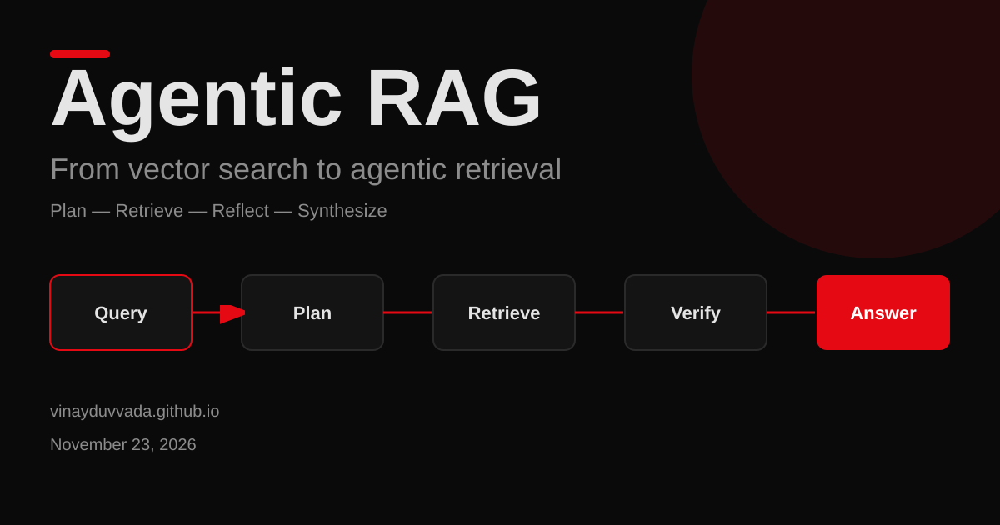
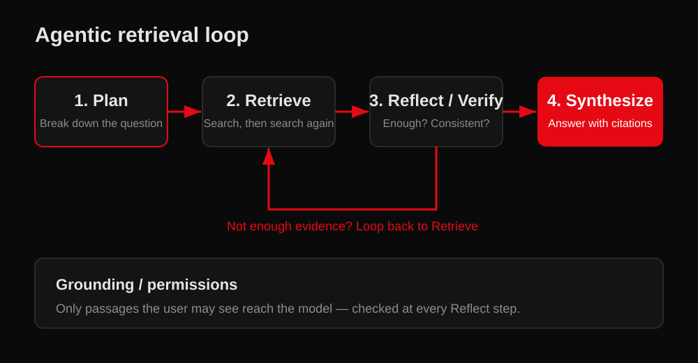

# Agentic RAG: From Vector Search to Agentic Retrieval

For a long time, retrieval-augmented generation had a simple shape. You chunked documents, embedded them, stored the vectors, and at query time searched for the nearest neighbours and handed them to a language model. It worked for demos, and badly enough in production that most teams learned the same lesson: retrieval was doing too little, and the model was doing too much guessing.

That is the change this post is about. Retrieval is no longer a single lookup. In the systems people are building now, retrieval is a loop. The system plans what it needs, searches, looks at what came back, decides whether it is good enough, searches again from a different angle, and only then writes an answer. When it works, the answer is more grounded. When it does not, you can see where it went wrong.

## What classic RAG got right, and where it broke

Classic RAG was a good first abstraction. It separated knowledge from the model, so you could update documents without retraining. It gave the model something concrete to quote instead of relying only on what it had memorised.

The problems were mostly retrieval problems. A query rarely maps cleanly to one search. A question spanning two documents, or needing a date, a definition, and a procedure, will not be served by one embedding lookup. The top results are often near-duplicates. The useful passage can sit just below the cutoff. Once the context is assembled, the model has no way to say the evidence is thin. It writes a confident answer anyway.

## Classic RAG vs Agentic RAG

| | Classic RAG | Agentic RAG |
|---|---|---|
| Query handling | One embedding search, as written | The query is planned and rewritten, sometimes into several searches |
| Retrieval | Single pass, fixed top-k | Iterative: retrieve, inspect, retrieve again |
| Evidence check | None, or a reranker score | Explicit reflection: is this enough, is it consistent, is it permitted? |
| Failure mode | Silent — wrong chunks, confident answer | Visible — the loop can stop, clarify, or say it cannot verify |
| Cost and latency | Predictable, one search and one generation | Variable, several searches and model calls |
| Best fit | Simple factual lookup over a stable corpus | Multi-step questions, mixed sources, answers needing citations |

Agentic RAG is a clear upgrade in capability. The catch is cost and latency. A system that sometimes makes one call and sometimes makes eight is harder to budget, harder to cache, and harder to keep fast. If your use case is a simple lookup, do not pay that price. Keep the straight line. Agentic retrieval earns its keep only when a single search is likely to miss something important.

## The retrieval loop: plan, retrieve, reflect, synthesize

The core idea is a loop, not a pipeline. It has four stages, and the third is the one that changes everything.

**Plan.** Before searching, the system breaks the question down. What facts are needed? What sources are likely to hold them? A vague query turned into two or three precise searches will beat one vague search almost every time.

**Retrieve.** This is the familiar step, but now it happens more than once, and each time it can be different. The first search might be broad. The second might target a specific document type, a date range, or a table.

**Reflect.** After each retrieval, the system inspects the results. Are the passages relevant? Do they agree? Do they cover the sub-questions from the plan? Reflection is also where permissions belong. A passage the user is not allowed to see should not reach the model, and should not leak into the answer through a summary.

**Synthesize.** Only when the evidence is good enough does the system write the answer, with citations to the passages it used. If the evidence is not good enough, the honest outcome is to loop back and search again, or to say plainly that the answer cannot be verified. That feels like a failure, but in production it is a feature. A system that says "I cannot verify this" is far more useful than one that invents a confident answer.

The loop needs a stopping rule: a maximum number of iterations, and a minimum evidence threshold. Log every iteration.

## Multimodal and index-time retrieval

Most RAG discussions still assume text. Real corpora are full of slides, scanned PDFs, tables, charts, and screenshots — and a text-only system will miss answers that live in a chart.

Two pieces of work from Bloomberg, presented around EMNLP 2026, attack the problem at different points.

The first is MIDR. The idea is to do visual reasoning once, at index time, instead of on every query. A document page is understood as a visual object when it is indexed, so retrieval can work with that understanding directly. The reported result was 23% better retrieval quality than standard BM25, and performance competitive against ColQwen2.5 on ViDoRe V3. Pay more once, at index time, so every query after that is cheaper and more accurate — a good trade when your corpus changes slowly, a bad one when documents change constantly.

The second is EvidenT, which separates evidence extraction from answer generation. Instead of asking one model call to find the evidence and write the answer, the system first extracts the evidence that supports an answer, then generates from that evidence. The reported result was 93% groundedness and a 29% improvement in expert-verified citation quality versus standard prompting baselines. Separating the stages makes drift visible, and citations checkable.

Together, they point the same way as the retrieval loop: stages that can be inspected and tested separately, not a single black box.

## Microsoft Ignite, November 2026: the build-vs-buy turning point

At Microsoft Ignite, held November 17-20, 2026, Microsoft presented Foundry IQ in public preview as a single permission-aware grounding API, with query planning, iterative search, and reflection built in, as part of Microsoft IQ with 350+ connectors. Alongside it, Foundry Agent Optimizer, multi-turn evaluation, and a model router across the top roughly 50 models went generally available, according to vendor reporting.

A single grounding API that plans queries, searches iteratively, reflects, and respects permissions is exactly the loop described above, packaged as a service. The connectors matter because retrieval is only as good as the sources it can reach. Multi-turn evaluation matters because a loop that runs for several turns cannot be evaluated with a single-turn test.

This is the build-vs-buy turning point, and I am not presenting it as an endorsement. Managed grounding is attractive because someone else maintains the index, the planning, and the evaluation harness. The cost is control. You do not control the retrieval strategy in detail, you do not control the latency profile, and you are trusting the vendor's permission model with sensitive documents. For many teams, that trade is worth it. For teams with strict data boundaries, unusual corpora, or a need to audit every retrieval decision, a hand-rolled pipeline is still right.

## A practical rebuild checklist

**Keep the cheap path where it works.** If your current pipeline serves simple lookups well, keep it for those queries. Add the agentic loop only for queries that need it.

**Decide build vs buy with a real test.** Do not decide from a demo. Take a sample of your own documents and hard questions and compare both options on the same criteria.

**Evaluate on permission-respecting recall.** Permission-respecting recall measures whether the right passages were found *and* only passages the user was allowed to see were used. Test with users who have different access levels.

**Evaluate grounding and citations, not just answer quality.** Check whether each claim is supported by a cited passage. Measure this on your own data before you ship.

**Measure latency and cost per query, by query type.** Log iterations, searches, and model calls per query, and set a budget per query type.

**Log the loop, and keep the evidence auditable.** Log every plan, search, retrieved passage, and reflection decision. Store the passages used for each answer, with source and version.

## Conclusion

Agentic RAG is not a new model. It is a new shape for retrieval: plan, retrieve, reflect, synthesize, and loop until the evidence is good enough or the system says it is not. Research and vendors are pointing the same way — retrieval as an inspectable system, with permissions and grounding built in, not bolted on.

That does not mean every team should rebuild everything tomorrow. It means the default has changed: start new systems with the loop, add it where it helps in existing ones, and measure the difference on your own data. Make the evidence visible.

## Sources and dates

- Microsoft Ignite 2026, Nov 17-20 — Foundry IQ: https://kdcube.tech/news/industry/ai/2026-11-19-news
- RAG Reinvented, late Oct 2026: https://www.andrewhansen.au/rag-reinvented-how-agentic-multimodal-retrieval-is-reshaping-enterprise-ai-in-2026/
- RAG research digest, Nov 22, 2026: https://scipapermill.com/2026/11/22/retrieval-augmented-generation-from-agentic-intelligence-to-enterprise-resilience/
