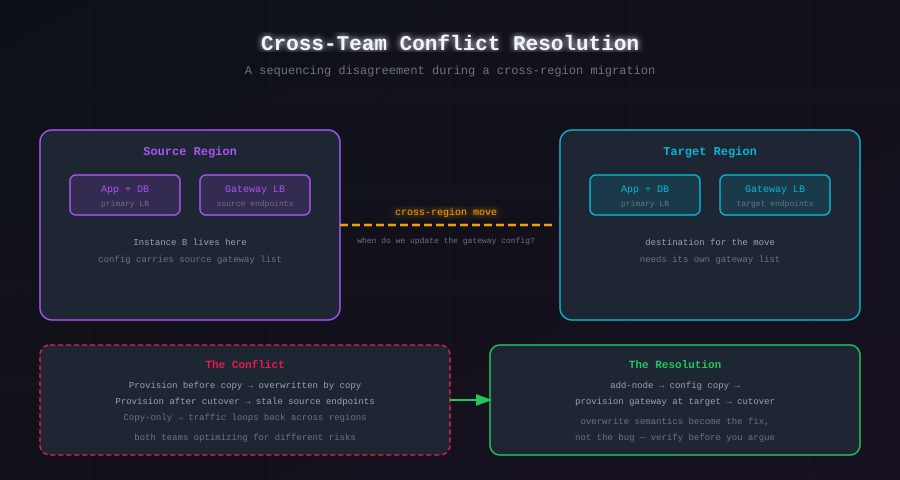

# Behavioral Interview: Resolving a Cross-Team Conflict During a Cross-Region Migration

One of the most common behavioral interview questions is: **"Tell me about a time you had a conflict while working across teams."** This post is my prepared answer, based on a real situation I navigated during a cross-region instance migration. I've generalized the details — no internal service names or people — but the technical substance and the resolution path are real.

## Situation

We support automated cross-region moves for customer instances. An instance being relocated can have a **secondary load balancer service** enabled — think of it as a regional traffic gateway layer that sits alongside the primary load balancer.

The move workflow has a well-defined sequence:

1. **Add-node** at the target site (stand up the new infrastructure)
2. **Configuration copy** — replicate the source site config to the target site
3. **Traffic cutover** — DNS switch so users hit the target region

The instance I was moving had the secondary load balancer enabled in the source region. The gateway endpoint list (FQDNs) is stored in the primary load balancer's custom configuration — so it travels with the config copy.

## The Conflict

The core disagreement: **when should the target site's secondary load balancer configuration be applied?**

- **My team's position (initial approach)**: Provision the secondary load balancer on the target site *before* the cutover, so it's ready to serve traffic immediately after the move. The problem — provisioning it before the configuration copy meant the copy would **overwrite** the freshly provisioned target endpoints with the source endpoints. We discovered the provisioning workflow replaces the whole endpoint list rather than appending.
- **The network team's position**: Provision *after* the move completes — i.e., post-DNS-switch. Their concern was about commit failures: if the target load balancer tried to commit a config referencing unreachable source-region endpoints, it could put the cluster into a paused state. They felt post-move provisioning was safer and operationally simpler.
- **The risk of doing nothing**: If we just let the config copy carry source endpoints to the target, traffic would take a "full loop" — the database and app nodes would live in the target region, but gateway traffic would still route back through the source region's endpoints. Extra latency, cross-region egress cost, and a hidden dependency on the source region we were trying to vacate.

So both proposals had a real flaw, and each team was optimizing for a different risk.

## Task

As the engineer driving the move workflow, I needed a sequence that:

- Didn't leave stale source-region endpoints on the target.
- Didn't risk load balancer commit failures mid-move.
- Landed the secondary load balancer in a correct state **before** traffic arrived.

## Action

Rather than pushing back on the email thread, I did three things:

1. **Validated the assumptions technically first.** I confirmed exactly what the copy API does — it copies everything except pools and pool members — and confirmed that the secondary load balancer endpoint field *does* get copied. I also confirmed whether a target-side commit would actually fail on cross-region endpoint references, rather than assuming it would.

2. **Laid out the failure modes neutrally.** In a reply to the whole thread, I described both orderings and their respective failure modes without advocating for "my" approach: provision-before-copy → overwritten config; copy-only → stale source endpoints and cross-region data flow; provision-post-move → a window where the instance runs on the wrong gateway.

3. **Proposed a third ordering that neither team had initially suggested**: add-node at target → configuration copy (source → target) → provision the secondary load balancer at target (which overwrites the stale source endpoints with correct target endpoints) → traffic cutover.

This worked because the provisioning workflow's overwrite behavior — the very thing that made the original sequencing dangerous — became a **feature** in the new ordering. It guaranteed the target config ended in a clean, correct state regardless of what the copy had deposited.

## Result

The network team validated the ordering, confirmed the commit path was safe under that sequence, and we adopted it as the standard approach for moving instances with the secondary load balancer enabled. No escalation needed — the conflict resolved once both teams could see the full data flow and the actual behavior of the provisioning API, rather than arguing from assumptions.

## What I Learned (and what I'd say in the interview)

- **Most cross-team conflicts are sequencing conflicts, not value conflicts.** Both teams wanted a safe move; we disagreed about ordering. Naming that out loud de-escalates fast.
- **Verify behavior before arguing about it.** Half the disagreement evaporated once we confirmed what the copy API and provisioning workflow actually did — instead of debating what we each *believed* they did.
- **Turn the constraint into the solution.** The overwrite semantics that broke the first approach became the mechanism that made the final approach robust.
- **Put the trade-offs in writing.** A single email that enumerates the failure modes of each option is worth five rounds of back-and-forth — it shifts the conversation from positions to a shared decision table.

If asked a follow-up — *"what would you do differently?"* — I'd say: involve the network team earlier, at design time rather than at the point of sequencing disagreement. The conflict was cheap to resolve; the next one might not be.
