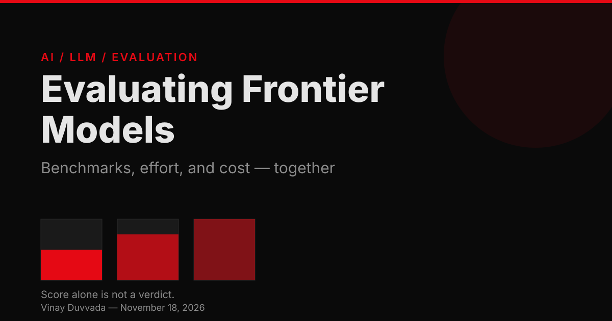
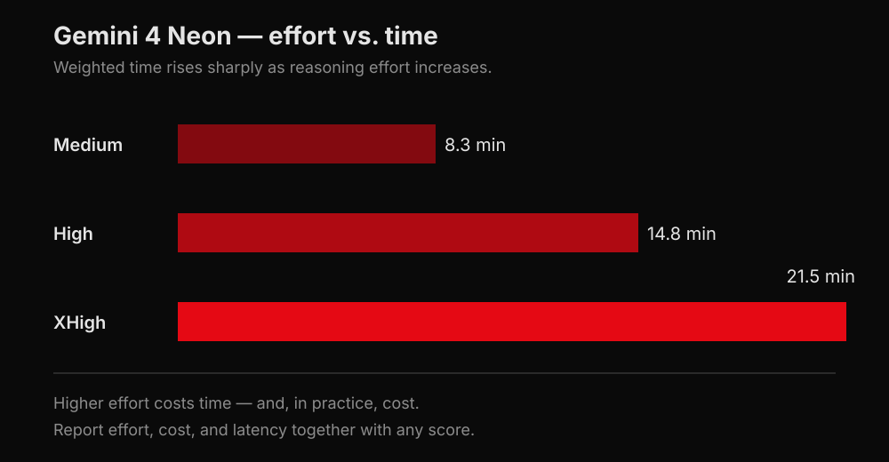

# Evaluating Frontier Models Without Fooling Yourself

A single benchmark score tells you almost nothing in November 2026. A model can look strong on one leaderboard and still be the wrong choice for your task, your budget, and your latency budget, because the number was measured at a reasoning effort you will not use, on a task you do not have, at a price you did not check.

This month made that concrete. Gemini 4 models arrived in quick succession, GPT-6.2 shipped to the API and Codex, LiveBench moved to a new question set, and a visual benchmark showed how far text scores can be from the rest of the work. None of those releases is, on its own, a verdict. Together, they show how to read a release month without fooling yourself.

My rule is simple: fix the task first, then read effort, cost, and latency together, then check long-context and visual cases separately. If a result does not give you the effort level, the price, and the time, treat it as incomplete.

## The Gemini 4 releases, in order

Gemini 4 did not arrive as one launch. Argon reached broader paid API availability on October 13. Carbon followed on November 10. Hydrogen followed on November 12. Neon followed on November 18. Comparing a model from October with one from mid-November without noting the date is already a mistake.

The comparison I am using gives the four models a unified context window of 1,048,576 tokens. That tells you what fits. It does not tell you how well the model uses the middle of that window, or what it costs to fill it.

The same comparison reports Artificial Analysis Intelligence Index v5 at stated effort levels. Neon and Carbon both score 60 at high reasoning effort. Neon scores 61 at xhigh. I am not filling in Argon and Hydrogen, because those scores were not in the facts I am working from.

| Model | Paid API availability | Context window | Intelligence Index v5 |
| --- | --- | --- | --- |
| Gemini 4 Argon | Oct 13 | 1,048,576 tokens | — |
| Gemini 4 Carbon | Nov 10 | 1,048,576 tokens | 60 at high |
| Gemini 4 Hydrogen | Nov 12 | 1,048,576 tokens | — |
| Gemini 4 Neon | Nov 18 | 1,048,576 tokens | 60 at high, 61 at xhigh |

Neon also shows why effort must travel with the score. Its weighted time is 8.3 minutes at medium effort, 14.8 minutes at high, and 21.5 minutes at xhigh. Going from medium to xhigh moves the index to 61, while time more than doubles. That does not make xhigh wrong. It makes it a choice: cheap for a hard offline analysis, expensive for an interactive product.

Name the model, name the date, name the effort, then look at the time.

## GPT-6.2: cheaper, not automatically better

GPT-6.2 Astra and Sol shipped on November 17 to the API and Codex. A result from before November 17 is not a GPT-6.2 result, and a result that does not say Astra or Sol is not one you can act on.

The pricing fact for Astra is vendor-reported: Astra is 20 percent cheaper than GPT-6, at $8 per million tokens for input and $40 per million tokens for output, vendor-reported. I am not adding a price for Sol, because I do not have one here. I am also not turning a price cut into a performance claim. Cheaper is a cost fact. Better is a task fact.

A cheaper model can be right for high-volume work even if it is not the strongest on a reasoning benchmark. A pricier model can be right for low-volume, high-stakes work even if a cheaper one is close on average. Measure the task you actually run, at the effort you actually use, and put the price next to the result.

Ask three questions: which model, Astra or Sol, and on what task? What were the input and output token counts, so the $8 and $40 rates, vendor-reported, become a real cost per task? What was the latency, and was it acceptable? If you cannot answer those, you do not have an evaluation.

## LiveBench 2.0: a new set, not a new leaderboard

The LiveBench 2.0 Reasoning result I am using is dated November 6, 2026. Gemini 4 Argon is top at 95.1 percent, followed by GPT-6 Astra at 92.7 percent and GPT-6.1 Sol at 92.6 percent.

Those numbers look like a ranking. They are not, unless you note what changed underneath. LiveBench 2.0 is a different question set from LiveBench 1.0, and it does not feed the BenchLeader Index. A 2.0 score and a 1.0 score are measurements on different sets, not two points on one trend line.

That does not make 2.0 useless. A new set can help when an old set has been seen too often. It does mean you should read the 2.0 numbers together, on the same set and date. The gap from 95.1 to 92.7 percent is 2.4 points. The gap between Astra and Sol is 0.1 points — small enough that it should not decide a product choice alone. It can move with a different prompt, effort level, or sample. If the two are close on your task too, choose on cost, latency, and held-out behaviour, not on a tenth of a point.

## Visual Cipher Bench: what text benchmarks miss

Visual Cipher Bench was released on November 12, 2026, by researchers from Naver Labs, Einsia.AI, and Tsinghua. It has 40 visual puzzles, with no text hints. The model must work from the image itself, over a long horizon, without a textual shortcut.

Many text benchmarks let a model succeed by pattern matching on words. A visual puzzle with no text hints removes that path, and the results show how much apparent reasoning was tied to text. The best frontier result here is GPT-6 Astra (max) at 26.7 percent, or 10.7 out of 40. GPT-6.1 Sol and Claude Opus 5.5 are at 21.7 percent.

A model can score in the 90s on a text set and still solve roughly a quarter of these puzzles. That does not mean the text score was fake. It means it measured something narrower than general reasoning.

If your product involves images, diagrams, or screenshots, a text benchmark will not tell you whether the model can do the job. Test the visual path separately, and accept that the scores will look worse than the text scores you are used to. Worse here is more honest. The benchmark is small — 40 puzzles — so do not over-read a single point. But the direction is clear: do not let a strong text result stand in for visual work.

## A checklist that actually works

- **Fix the task first.** Write, in one paragraph, what the model must do and what good and bad answers look like. If you cannot write that, you are exploring, not evaluating.
- **Report effort, cost, and latency together.** For every result, note the model, date, effort level, token counts, price per task, and time per task. Neon at 8.3, 14.8, and 21.5 minutes is the template.
- **Use a held-out set.** Keep examples you do not tune on. A gain on tuned examples shows tuning works. A gain on held-out examples says something about the model.
- **Check long context separately.** A 1,048,576-token window tells you what fits, not whether the model finds the relevant passage in the middle. Test short, medium, and long versions separately.
- **Distrust saturated benchmarks.** MMLU is saturated, according to BenchLeader, which tracks 299 benchmarks, as of November 24, 2026. Saturated benchmarks stop separating top models. Use a newer, harder, or more task-specific set for close calls.
- **Write the decision down.** One page: task, models, effort levels, held-out results, cost, latency, and your choice. That record makes the next release month easier.

## Conclusion

November 2026 did not give us a single winner. It gave us dated, effort-specific, price-specific results that only make sense together. Gemini 4 arrived in stages, with a unified 1,048,576-token window and Neon times rising sharply with effort. GPT-6.2 Astra and Sol shipped on November 17, with Astra vendor-reported as 20 percent cheaper than GPT-6. LiveBench 2.0 gave a new set, not a continuation of the old leaderboard. Visual Cipher Bench showed that text scores can hide a large visual gap.

Fix your task, measure it on held-out examples, and report effort, cost, and latency with the score. Do that, and a release month becomes useful instead of confusing.

## Sources and dates

- Gemini 4 comparison, as of Nov 19, 2026: https://dev.to/modelflare_dev/gemini-4-models-compared-on-reasoning-coding-and-context-55p3
- Visual Cipher Bench, published Nov 15, 2026: https://casrai.org/news/visual-cipher-bench-llm-agents-long-horizon-visual-reasoning-2026
- LLM benchmarks, Nov 2026: https://www.benchleader.com/benchmarks
- LiveBench 2.0 Reasoning, data as of Nov 24, 2026: https://www.benchleader.com/benchmarks/livebench2_reasoning
- GPT-6.2 / Ignite week summary, Nov 19, 2026: https://kdcube.tech/news/industry/ai/2026-11-19-news
