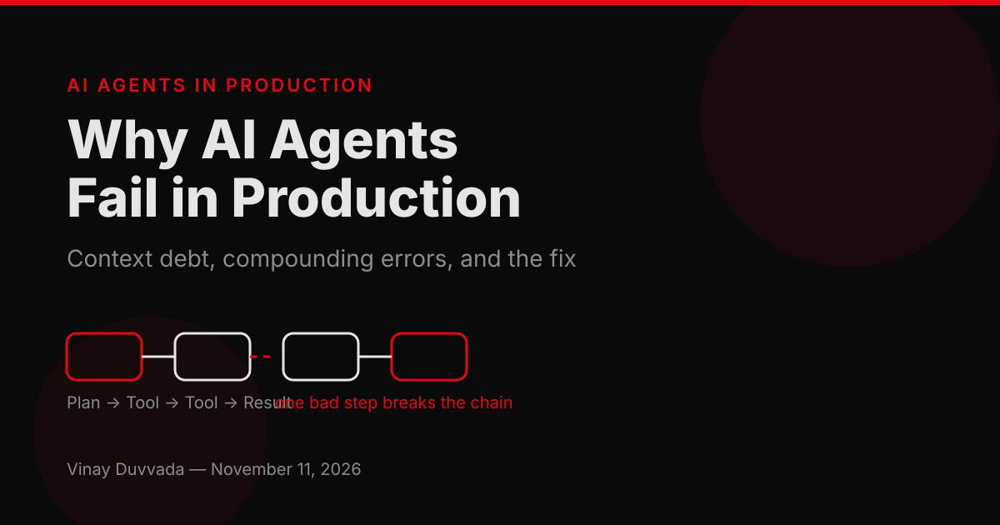
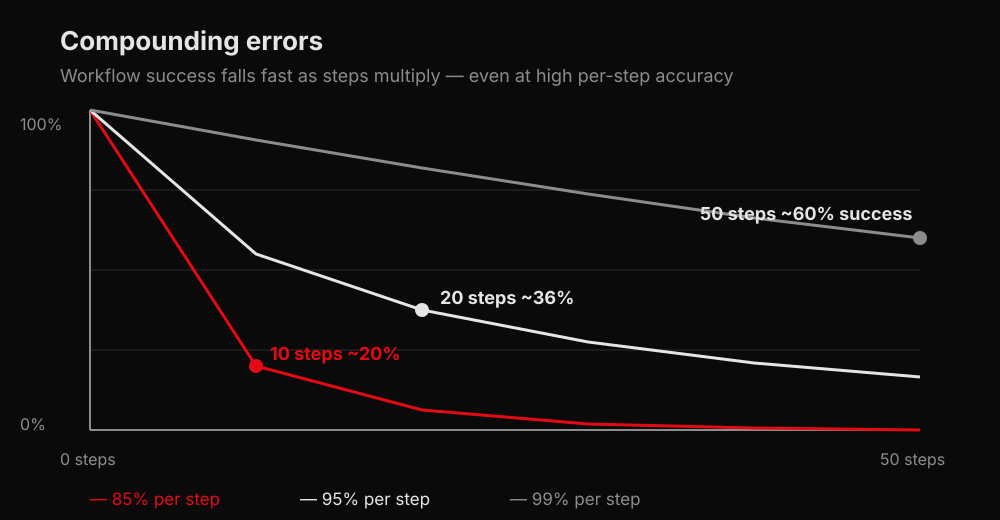

# Why AI Agents Fail in Production

Most agents do not fail because the model is weak. They fail because the system around the model is weak. A demo works because the data is clean, the task is short, and someone is watching. Production is the opposite: the data is messy, the task is long, and nobody is watching until a customer complains.

Two forces explain most production failures: compounding errors and context debt. Neither is solved by a bigger model. Both are solved by engineering discipline — shorter horizons, explicit contracts, and evaluation that looks like production, not like a demo.

## The failure numbers are hard to ignore

These are repeated findings from 2025, not anecdotes from one bad rollout.

| Source | Finding |
|---|---|
| S&P Global, 2025 | 42% of companies abandoned most AI initiatives in 2025; the average organisation scrapped 46% of proof-of-concept projects before production. |
| IDC / Lenovo, 2025 | 88% of AI proof-of-concept projects never reach production; only 4 of every 33 launched projects survive. |
| Gartner, 2025 | Over 40% of agentic AI projects will be cancelled by the end of 2027. |
| MIT NANDA, 2025 | Roughly 95% of enterprise GenAI pilots delivered no measurable profit-and-loss impact. |

The MIT NANDA finding is the most honest. A pilot can look successful in a slide deck while changing nothing on the profit-and-loss statement. If the agent does not measurably save time, reduce cost, or increase revenue, it has not succeeded in production.

## Compounding errors: small mistakes become certain failures

An agent is a chain of steps. It reads a request, plans, calls a tool, reads the result, and plans again. Each step has a chance of being right. The chance the whole chain is right is the product of the chances at each step, and products shrink fast.

- 85% per step over 10 steps: about 20% success (0.85 to the power of 10).
- 95% per step over 20 steps: about 36% success.
- 99% per step over 50 steps: fails roughly 40% of the time — success is only about 60%.

A step right 99 times out of 100 sounds excellent. Run it 50 times and you should expect a failure almost half the time. Fifty steps is not unusual once you count planning, tool calls, retries, and checks.

The APEX-Agents 2026 benchmark makes the same point from the other side. Even the best models complete only 24% of real-world tasks on the first attempt. Plan for that: three out of four tasks will need a retry, a correction, or a human in the loop.

If your agent cannot detect a bad step, recover from it, or stop before it does damage, a long workflow is a lottery ticket. Shorten the chain, check the work at each checkpoint, and design for failure as the normal case.

## Context debt is the root cause

If compounding errors are the mechanism, context debt is the root cause: the gap between what the agent assumes your data means and what your business actually means.

A column called `status` might mean one thing in sales, another in support, and a third in finance. A term like "active" might include trial users in one report and exclude them in another. Humans learn these meanings over months. An agent reads the label and guesses.

When the guess is wrong, the agent rarely says "I do not know." It produces a confident, well-formatted answer that is wrong in a way that is hard to spot. That is the most dangerous failure mode in production, because it looks like success.

| Failure mode | Root cause | Fix |
|---|---|---|
| Inconsistent answers | The same term means different things in different systems, with no governed definition. | Governed glossary: one definition per business term, owned and versioned. |
| Authoritative hallucination | No persistent memory of what is true in your organisation, so the agent fills gaps with plausible text. | Persistent context layer: facts, decisions, and corrections stored across sessions. |
| Works in testing, breaks in production | Testing uses clean data; production data is messy and full of edge cases. | Dashboard-as-eval: evaluate on real production data and dashboards, not a fixed test set. |
| Fails to scale beyond one use case | Each team builds its own prompts, tools, and definitions, so nothing is reusable. | Shared context layer via MCP/API: every agent reads the same definitions and tools. |
| Adoption stalls | Users cannot see why the agent did what it did, so they stop trusting it. | Audit trail: every action, tool call, and source, recorded and replayable. |

Context debt also explains why an agent that works in one team fails in the next. The first team built shared context informally — in chat, in reviews, in hallway conversations. The second team does not have it, and neither does the agent. If context lives only in people's heads, it cannot scale. It has to live in a system the agent can read.

## What changed in November 2026

November 2026 was useful because the announcements were not about bigger models. They were about evaluation, shared context, and agents inside real tools.

On November 11, 2026, AWS announced the Universal Agent Evaluation Framework. It is framework-agnostic, and it normalises traces from LangGraph, LangChain, Strands Agents, and Bedrock AgentCore, so teams can evaluate agents built on different frameworks in the same way.

On November 10, 2026, Anthropic announced Claude Meetings, Whiteboards, and Sheets. Meetings is in beta for Team and Enterprise plans, with Google Meet support initially. Agents are moving into the tools where work already happens.

Snowflake's 2026 research adds a concrete number. Adding an organisational ontology improved agent accuracy by 20% and reduced tool calls by about 39%.

Together, these point the same way. The industry is moving from "build an agent" to "build the context and evaluation around the agent."

## A practical production checklist

**Shorten horizons with checkpoints.** Break long workflows into short stages, each with a clear output and a check. If a stage fails, stop, retry that stage, or escalate to a human.

**Use explicit memory contracts.** Decide, in writing, what the agent may remember, what it must forget, and what it must re-check every time. Without that contract, the agent will remember the wrong thing at the wrong time.

**Write tool descriptions and error messages as if a new engineer will read them.** A tool description should say what the tool does, what it does not do, what inputs are required, and what success looks like. An error message should say what went wrong and what to do next.

**Set hard cost ceilings per session and per task.** Agents can loop, retry, and call expensive tools many times. A ceiling is a circuit breaker. When it is hit, the agent stops and escalates.

**Build observability and replayable traces from day one.** Log every step, every tool call, every input and output, and keep the trace so you can replay it. When something goes wrong — and it will — you need to answer: what did the agent see, what did it do, and why did it do it?

None of these require a new model. All of them require treating the agent as a production system: contracts, limits, checks, and logs.

## Conclusion

Agents do not fail in production because the model is weak. They fail because errors compound across steps, and because the agent is running on a different understanding of your business than your business actually has.

Most proof-of-concept projects never reach production, and most pilots change nothing on the profit-and-loss statement. Even the best models complete only 24% of real-world tasks on the first attempt, according to the APEX-Agents 2026 benchmark. The rest need structure — checkpoints, retries, and human oversight — to succeed.

The fix is work, not mystery. Build a governed glossary so terms mean one thing. Build a persistent context layer so facts survive a session. Evaluate on real production data. Share context through MCP or an API. Keep an audit trail so every action can be explained and replayed.

Start small, measure honestly, and treat context as the product. The model will get better on its own. Your context will only get better if you build it.

## Sources and dates

- Scaling agentic AI to production, 2026: https://atlan.com/know/ai-agent/ai-agent-scaling-in-production/
- Why AI agents fail in production, 2026: https://atlan.com/know/why-ai-agents-fail-in-production/
- Why your agent keeps failing in production: https://www.designkey.studio/post/why-your-agent-keeps-failing-in-production
- AI agent failures taxonomy, 2026: https://www.metacto.com/blogs/ai-agent-failures-and-how-to-avoid-them
- AWS / Anthropic November 2026 announcements summary: https://jhparmar.medium.com/the-big-picture-ff9d1b1c8e1b
